# Local demo walkthrough

Screenshots were captured from the production build running against the seeded local database (`node scripts/demo-screenshots.mjs`).
Demo content is marked "(Demo)". Payments use the labelled development mock.

## Try it yourself

1. Start the stack (README > Run it locally) and open http://localhost:3000 on a phone-sized window.
2. **Guest:** browse the home page, search "phone", filter by category or region, switch the market to Ghana (prices change to GHS),
   then open a listing and a storefront.
3. **Buyer** (`buyer@naira.test` / `Password123!`): message a seller, make an offer, save items, follow a shop, report a listing.
4. **Seller** (`chioma@naira.test`): open Messages and counter or accept the offer; the buyer can then leave a review. Post a new listing
   with a photo; pause and reactivate it.
5. **Credits** (`tunde@naira.test`): Dashboard > Credits > Buy Starter > "Simulate successful payment". The balance rises by 50 only after
   the signed webhook. Then promote a listing on the homepage and open the homepage in a private window to see the "Sponsored" card.
   Impressions and clicks appear on the Promotions page.
6. **Admin** (`admin@naira.test`): /admin has stats, moderation, reports, users (suspend, adjust credits), verifications, countries,
   categories, policies, packages, campaigns, plans, payments and the audit log.
7. **Privacy:** Account > Download my data / Deactivate / Delete account.
8. **PWA:** install from the browser menu, then go offline. Visited public pages show a "saved copy" banner; other pages show the
   offline page.

## Screenshots

| | |
| --- | --- |
| 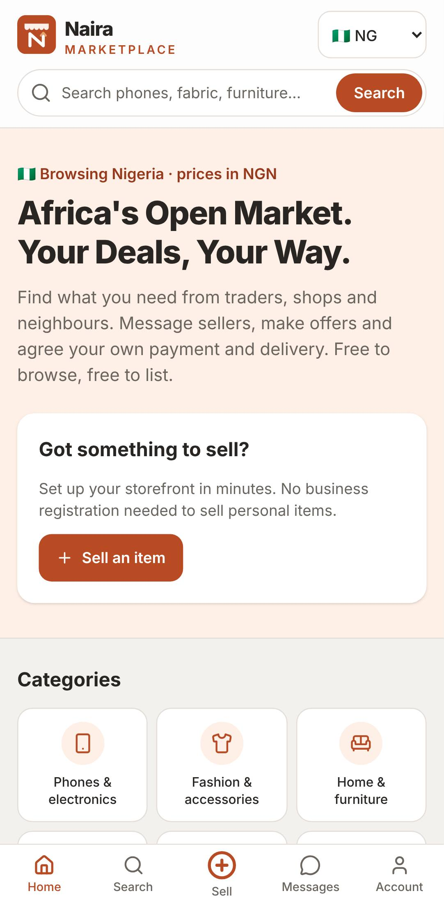 Home (phone) | 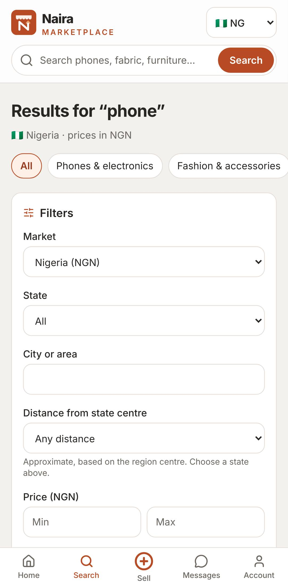 Search |
| 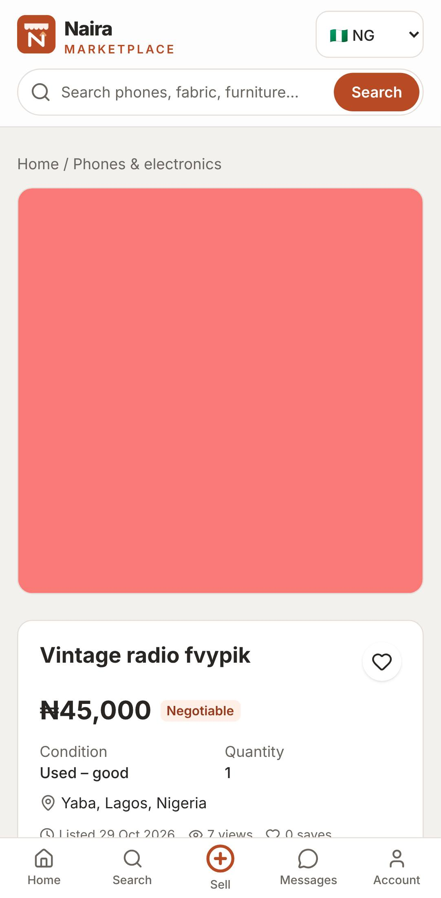 Listing | 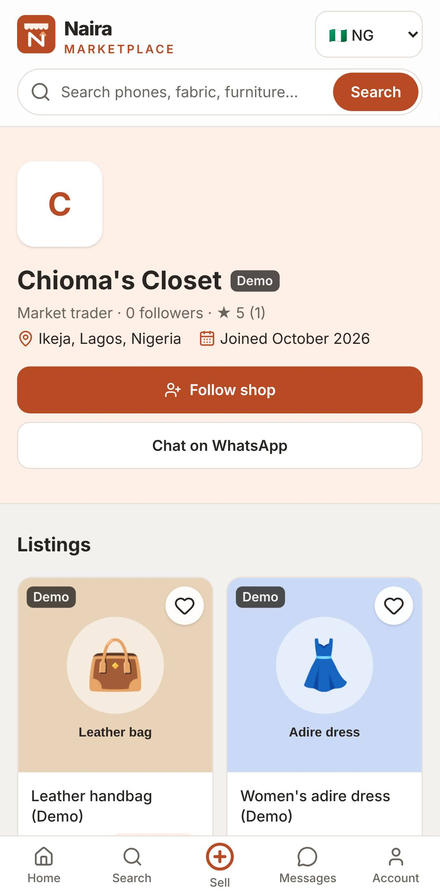 Storefront |
| 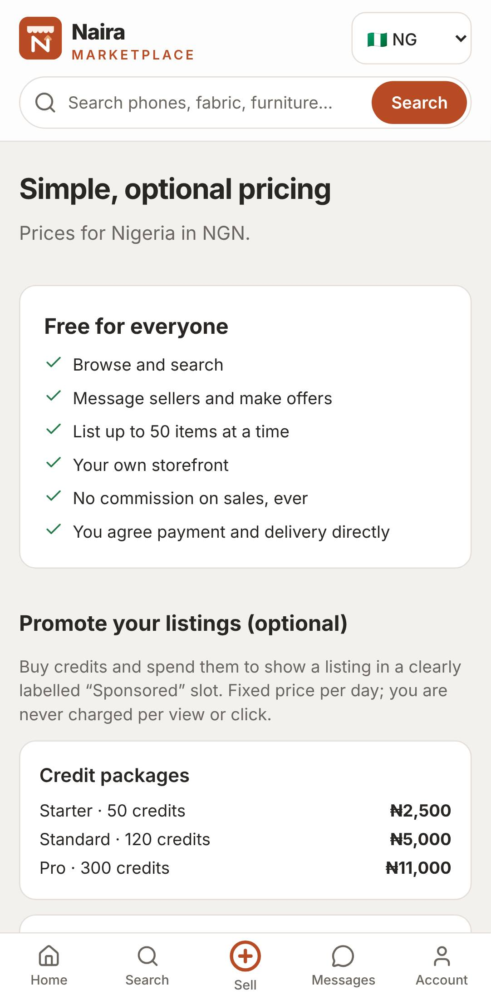 Pricing | 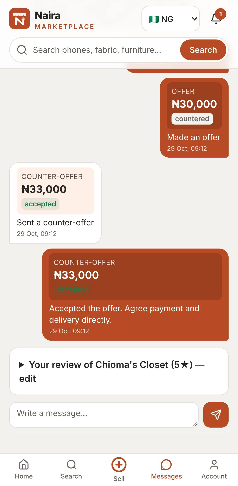 Negotiation |
| 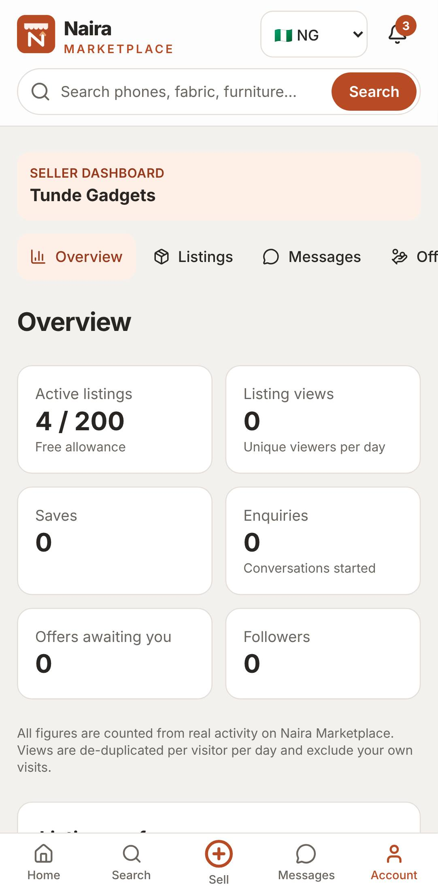 Seller dashboard | 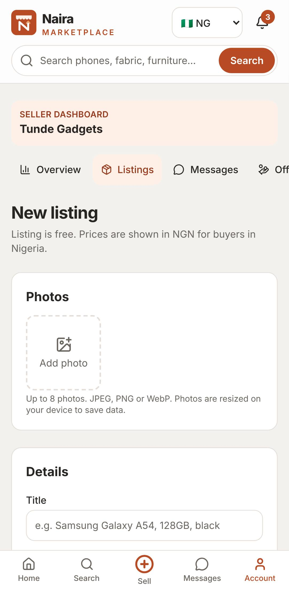 New listing |
| 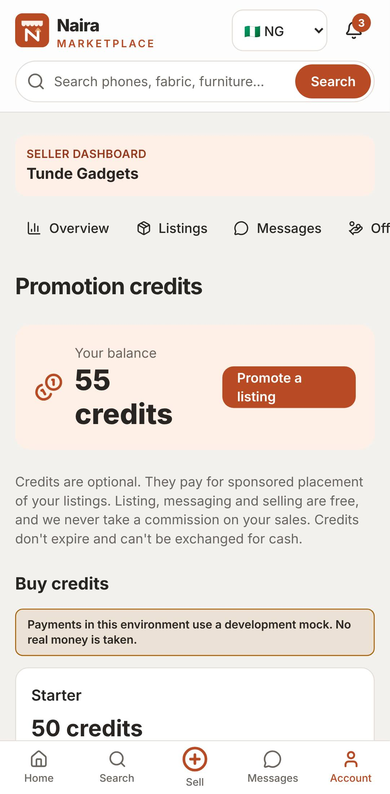 Credits | 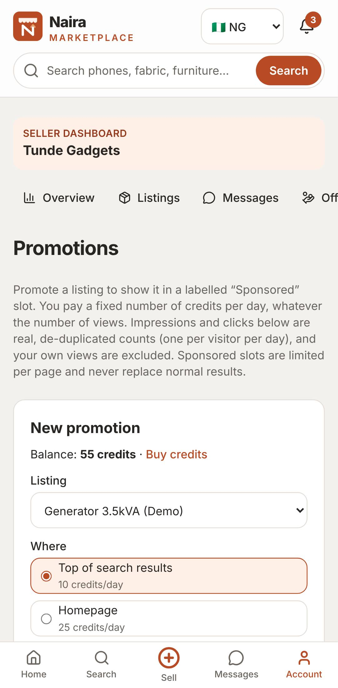 Promotions |
| 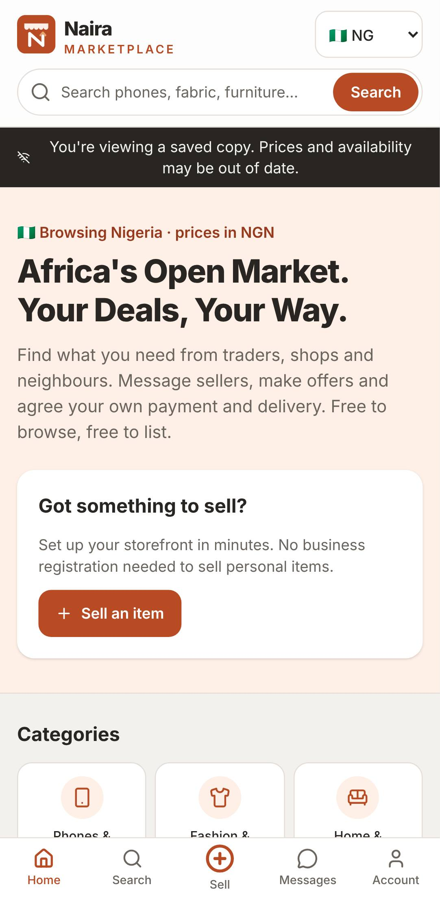 Offline saved copy | 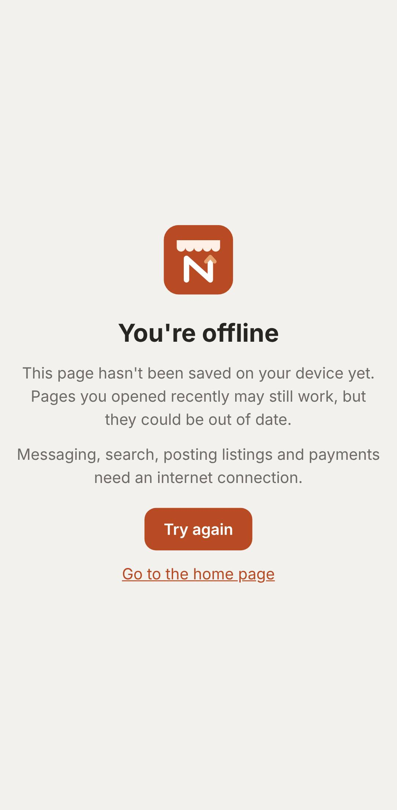 Offline fallback |

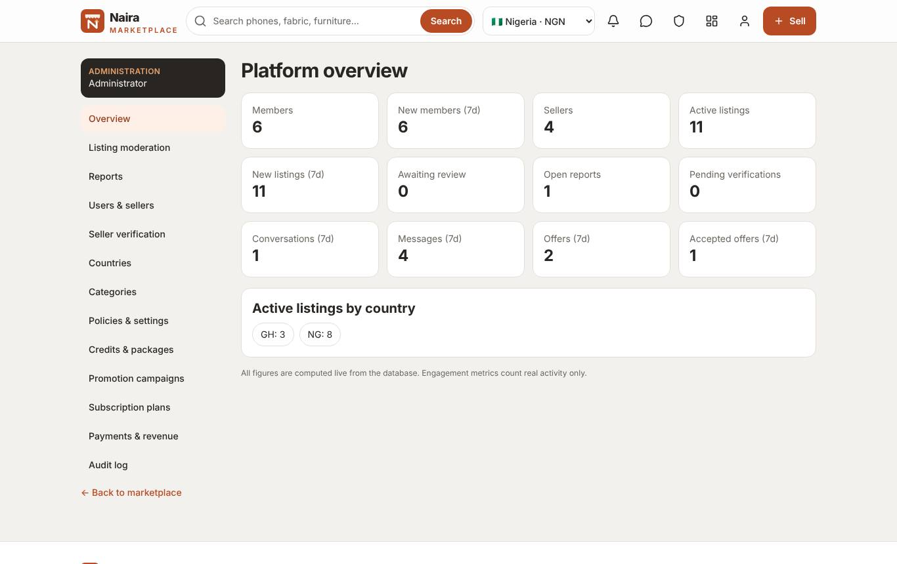
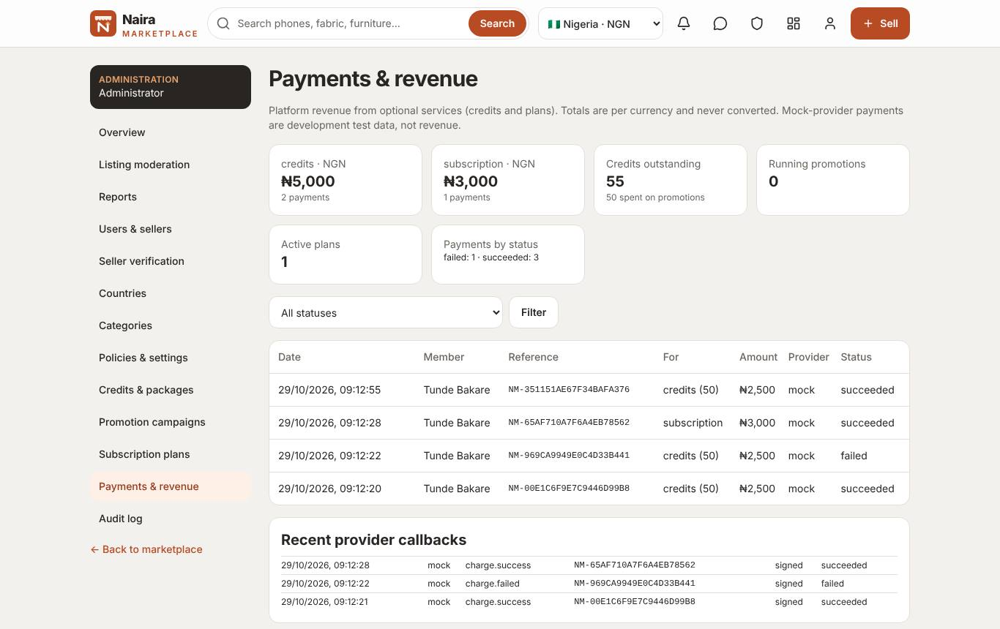
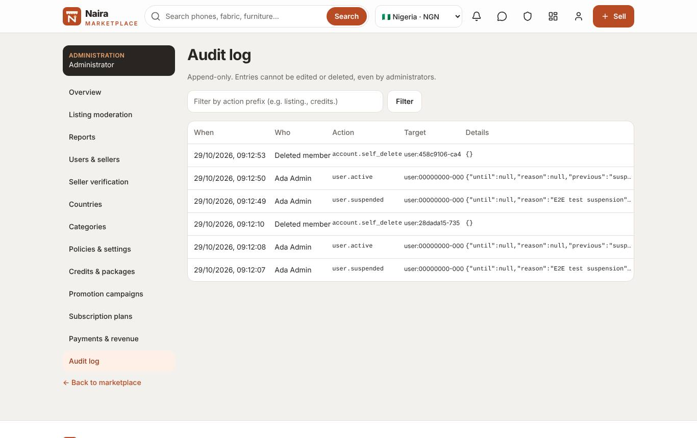
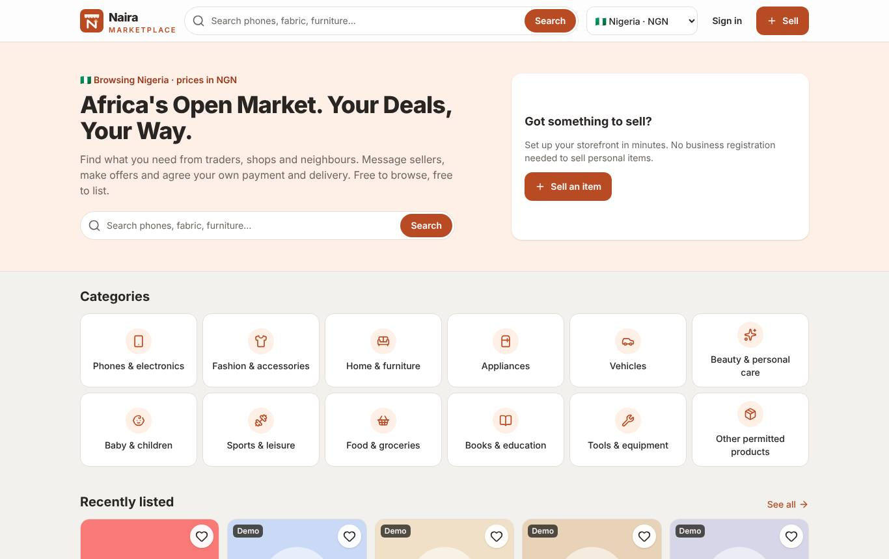
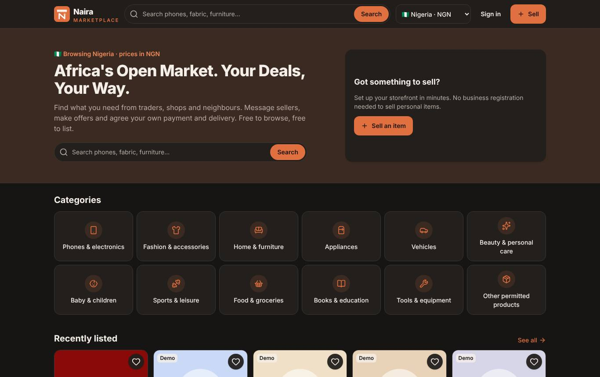
